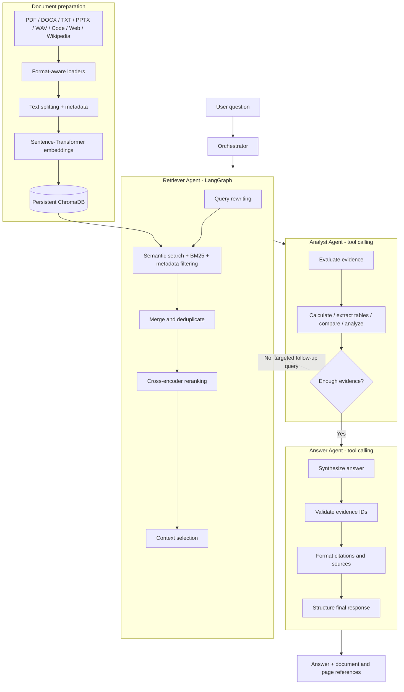

<div align="center">

# Agentic Hybrid RAG

### A collaborative, evidence-grounded document question-answering system

**Three specialized agents. Hybrid retrieval. Verifiable source citations.**

[](https://www.python.org/)
[](https://www.langchain.com/)
[](https://www.langchain.com/langgraph)
[](https://www.trychroma.com/)
[](LICENSE)

A multi-agent **Retrieval-Augmented Generation (RAG)** pipeline that searches across documents, analyzes retrieved evidence, and produces clear answers linked to their original sources.

[Architecture](#architecture) · [Features](#key-features) · [Getting Started](#getting-started) · [Usage](#usage) · [Testing](#testing)

</div>

---

## Overview

Traditional RAG systems often follow a single path: retrieve relevant text and pass it directly to a language model for an answer. **Agentic Hybrid RAG** separates that process into three focused responsibilities:

1. **Retriever Agent** — finds relevant evidence using a combination of semantic and keyword-based techniques.
2. **Analyst Agent** — interprets the evidence, uses tools for calculations and comparisons, and can request more information when needed.
3. **Answer Agent** — turns the analysis into a readable response with validated references to the retrieved sources.

An **Orchestrator** connects these agents, while a persistent **ChromaDB** knowledge base stores searchable document chunks. The design emphasizes traceability, modularity, and the separation of retrieval, reasoning, and answer generation.

## Key Features

| Capability | Implementation |
| --- | --- |
| **Multi-agent workflow** | Dedicated Retriever, Analyst, and Answer agents coordinated by an Orchestrator |
| **Hybrid search** | ChromaDB semantic similarity + BM25 keyword search |
| **Smarter retrieval** | Query rewriting, metadata filtering, cross-encoder reranking, and context selection |
| **Adaptive evidence gathering** | Analyst can send follow-up searches to the Retriever when evidence is insufficient |
| **Tool-assisted analysis** | Calculations, table extraction, cross-document comparison, and numerical analysis |
| **Grounded responses** | Validates evidence IDs, resolves source/page references, and rejects unverifiable citation drafts |
| **Multi-format ingestion** | PDFs, Word documents, text, presentations, WAV audio, source code, web pages, and Wikipedia |
| **Persistent knowledge base** | Local ChromaDB storage with deterministic chunk IDs and source metadata |
| **Inspectable execution** | Agent tool calls, analysis output, retrieved evidence, and execution timing are returned by the Orchestrator |

## Architecture



The Retriever uses **LangGraph** for its search workflow. The Analyst and Answer agents use **LangChain tool-calling**, and `core/orchestrator.py` coordinates their execution. The Analyst's follow-up retrieval loop is managed in `core/analyst_agent.py`.

### 1. Retriever Agent — Find the right evidence

**Files:** [`core/retriever_agent.py`](core/retriever_agent.py) and [`core/retriever_tools.py`](core/retriever_tools.py)

The Retriever collects relevant document excerpts without producing the final answer. Its six retrieval capabilities are:

| Tool | Purpose |
| --- | --- |
| Query Rewriter | Clarifies the question and generates retrieval-friendly alternatives, optionally using chat history |
| Semantic Search | Finds conceptually similar chunks using vector embeddings |
| Keyword Search | Uses BM25 to match important words and exact terminology |
| Metadata Filter | Narrows retrieval using available source and page metadata |
| Reranker | Reorders candidates using a cross-encoder model |
| Context Selector | Selects a compact, diverse set of relevant chunks for analysis |

Semantic search helps with **meaning**; BM25 helps with **exact terms**. Combining both reduces dependence on a single retrieval signal.

### 2. Analyst Agent — Reason over the evidence

**Files:** [`core/analyst_agent.py`](core/analyst_agent.py) and [`core/analyst_tools.py`](core/analyst_tools.py)

The Analyst works with the Retriever's evidence and can call five tools:

| Tool | Purpose |
| --- | --- |
| `calculator` | Evaluates arithmetic and supported mathematical expressions |
| `table_extractor` | Extracts structured information from text-based tables |
| `document_comparison` | Compares findings and attributes across sources |
| `data_analysis` | Summarizes and ranks numerical values |
| `request_more_evidence` | Requests another targeted retrieval pass when the available information is insufficient |

**Feedback loop:** When more information is needed, the Analyst asks the Retriever for additional chunks and re-evaluates the expanded evidence set. The number of follow-up rounds is configurable; the Orchestrator defaults to **two**.

### 3. Answer Agent — Explain and cite

**Files:** [`core/answer_agent.py`](core/answer_agent.py) and [`core/answer_tools.py`](core/answer_tools.py)

The Answer Agent combines the question, Analyst findings, and retrieved evidence to produce a readable response. Its three tools are:

| Tool | Purpose |
| --- | --- |
| `citation_formatter` | Maps original evidence IDs such as `[E2]` to consistent reader-facing references |
| `source_formatter` | Builds the corresponding sources section and deduplicates repeated source/page references |
| `response_formatter` | Structures direct answers, key points, calculations, and comparisons |

**Citation handling matters:** The final answer is checked against the actual evidence IDs. If the model invents a citation or fails to supply verifiable references, the implementation returns a verification-failure response rather than presenting an unsupported answer as sourced.

> **Example only — not a captured system run**
>
> **Question:** What are the benefits of retrieval-augmented generation?
>
> **Answer:** It can incorporate information from retrieved documents without retraining the underlying model **[1]**.
>
> **SOURCES:**  
> [1] `rag_overview.pdf`, page 3

Page references depend on metadata provided by the original loader. Non-paginated sources may not have a meaningful page number.

## Document Ingestion

The knowledge-base pipeline is implemented in [`database/chroma_pipeline.py`](database/chroma_pipeline.py) and uses format-aware loaders from [`core/loaders.py`](core/loaders.py).

| Input | Processing |
| --- | --- |
| `.pdf` | PyMuPDF text extraction with available PDF metadata |
| `.docx` | Word text extraction |
| `.txt` | Plain-text loading |
| `.ppt`, `.pptx` | Presentation text extraction; fallback loader when necessary |
| `.wav` | Speech transcription with Faster-Whisper (CPU, INT8 in the current loader) |
| Source-code files | Language-aware parsing for supported programming extensions |
| Website URL | Web page loading |
| Wikipedia URL or `wiki:Topic` | Wikipedia article loading |

After loading, the pipeline splits content with `RecursiveCharacterTextSplitter`, creates embeddings using **`sentence-transformers/all-MiniLM-L6-v2`**, and upserts chunks into a persistent ChromaDB collection. Defaults are **1,000 characters per chunk** and **150 characters of overlap**.

The knowledge base also exposes methods to ingest multiple sources, list stored sources, inspect statistics, delete an individual source, or clear the collection.

## Tech Stack

- **Language:** Python
- **Agent orchestration:** LangGraph, LangChain
- **Language models:** OpenRouter through LangChain's `ChatOpenAI` client
- **Vector database:** ChromaDB (persistent local storage)
- **Embeddings:** `all-MiniLM-L6-v2`
- **Keyword retrieval:** `rank-bm25`
- **Reranking:** `cross-encoder/ms-marco-MiniLM-L-6-v2`
- **Document processing:** PyMuPDF, docx2txt, python-pptx, LangChain document loaders
- **Audio transcription:** Faster-Whisper
- **Testing:** pytest and mocked language-model responses

## Project Structure

```text
agentic-hybrid-rag/
├── config/
│   └── settings.py             # Model, retrieval, and agent settings
├── core/
│   ├── loaders.py              # Format-aware document loaders
│   ├── retriever_agent.py      # LangGraph retrieval workflow
│   ├── retriever_tools.py      # Hybrid-search and selection tools
│   ├── analyst_agent.py       # Evidence analysis and feedback loop
│   ├── analyst_tools.py       # Calculation and analysis tools
│   ├── answer_agent.py        # Final answer generation and validation
│   ├── answer_tools.py        # Citation, source, and response tools
│   └── orchestrator.py        # Connects the three agents
├── database/
│   └── chroma_pipeline.py     # Ingestion, embedding, persistence, retrieval
├── tests/
│   ├── test_retriever.py
│   ├── test_analyst.py
│   └── test_answer.py
├── .env.example
├── .gitignore
├── requirements.txt
├── LICENSE
└── README.md
```

## Getting Started

### Prerequisites

- **Python 3.10 or later** (Python 3.11 is a reasonable environment choice)
- `pip` and Git
- An **OpenRouter API key** and access to a compatible model
- Internet access for initial model downloads and external LLM calls

> The repository provides a **Python API**, not a finished web or desktop interface. The following examples run from the project root.

### 1. Clone the repository

```bash
git clone https://github.com/Osama2004o/agentic-hybrid-rag.git
cd agentic-hybrid-rag
```

### 2. Create a virtual environment

**Windows PowerShell**

```powershell
py -m venv .venv
.\.venv\Scripts\Activate.ps1
```

**macOS / Linux**

```bash
python3 -m venv .venv
source .venv/bin/activate
```

### 3. Install dependencies

```bash
python -m pip install --upgrade pip
python -m pip install -r requirements.txt
```

Some optional formats and integrations (for example, Wikipedia, certain web pages, or presentation fallback extraction) may need additional dependencies specific to their loaders.

### 4. Configure your environment

Copy `.env.example` to `.env` and add your API key:

```dotenv
OPENROUTER_API_KEY=your_openrouter_api_key_here
LLM_MODEL=openrouter/free
```

`LLM_MODEL` is optional: `config/settings.py` defaults to `openrouter/free`. You can select another model supported by your OpenRouter account. Model availability, pricing, limits, and tool-calling support depend on the provider and selected model.

**Never commit `.env` or real API credentials.**

## Usage

The most direct way to use the system is to ingest a document, then call the Orchestrator. Create a file called `demo.py` in the **project root**:

```python
from database.chroma_pipeline import KnowledgeBasePipeline
from core.orchestrator import run_orchestrator

# 1. Create or reopen the persistent local knowledge base.
pipeline = KnowledgeBasePipeline()

# 2. Replace this with the actual path to one of your files.
ingestion = pipeline.ingest("path/to/your/document.pdf")
print("Ingestion:", ingestion)

if ingestion["status"] != "success":
    raise RuntimeError("Document ingestion did not succeed")

# 3. Ask a question about the ingested content.
result = run_orchestrator(
    query="What are the main findings in this document?",
    pipeline=pipeline,
    source_style="numbered",
)

print("\nANSWER\n")
print(result["answer"])
print("\nExecution time:", result["execution_time_seconds"], "seconds")
```

Run it with:

```bash
python demo.py
```

To ingest several sources, use the existing batch method:

```python
results = pipeline.ingest_batch([
    "path/to/paper.pdf",
    "path/to/notes.docx",
    "wiki:Retrieval-augmented generation",
])
print(results)
```

Or explore the knowledge base directly:

```python
print(pipeline.get_stats())
print(pipeline.list_sources())
```

The Orchestrator returns a dictionary containing the final `answer`, `sources`, retrieved `evidence`, Analyst `analysis`, agent tool-call traces, and `execution_time_seconds`.

## Testing

The repository includes dedicated tests for each part of the system:

```bash
python -m pytest tests/ -q
```

Run specific suites during development:

```bash
python -m pytest tests/test_retriever.py -q
python -m pytest tests/test_analyst.py -q
python -m pytest tests/test_answer.py -q
```

The Answer Agent tests exercise citation mapping, duplicate references, invalid evidence IDs, PDF page metadata, source formatting, and simulated agent execution. **Mocked unit tests do not replace a real end-to-end test** with an ingested document and an active OpenRouter model.

## Configuration

The main defaults are defined in [`config/settings.py`](config/settings.py), with additional pipeline settings in [`database/chroma_pipeline.py`](database/chroma_pipeline.py).

| Setting | Current default | Description |
| --- | --- | --- |
| `LLM_MODEL` | `openrouter/free` | Language model selected through OpenRouter |
| `OPENROUTER_BASE_URL` | `https://openrouter.ai/api/v1` | LLM API endpoint |
| Embedding model | `all-MiniLM-L6-v2` | Creates document and query embeddings |
| Chroma persistence path | `./database/chroma_db` | Local vector database location |
| Chunk size / overlap | `1000` / `150` | Text splitting during ingestion |
| Analyst feedback rounds | `2` | Maximum additional retrieval rounds via Orchestrator |
| Source style | `numbered` | Default final reference format |


## License

Distributed under the [Apache License 2.0](LICENSE).


